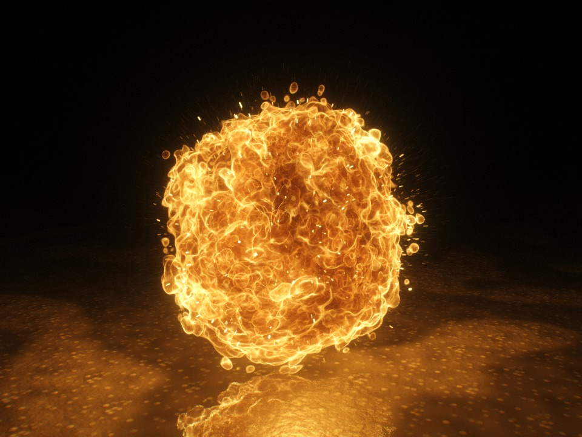
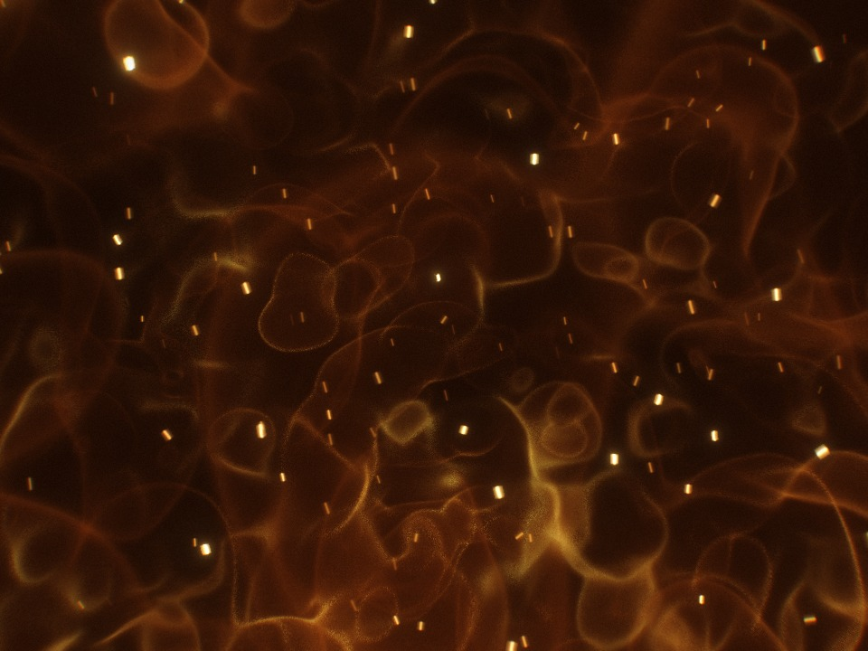

# Firebloom

A real-time volumetric fireball in a single HTML file. WebGL 2 and Web Audio, no libraries, no build step, no external assets.

**[Live demo](https://aureliengmz.github.io/firebloom/)** · drag to orbit · scroll or pinch to fly into the fire · click for sound

▶ [Watch the video](media/firebloom.mp4) (slow motion, flying into the fire, with sound)

## Run

Open `index.html` in a recent desktop browser (Chrome, Edge, Firefox or Safari 15+), from disk or any static host. Nothing to install.

Needs WebGL 2. Sound starts on the first click or key press, as browsers require.

| Control | Mouse / touch | Keyboard |
| --- | --- | --- |
| Orbit | Drag | Left / right arrows |
| Fly closer, or inside | Scroll wheel or pinch | Up / down arrows |
| Reset the camera | Double-click | |
| Play / pause | Play button | Space |
| Scrub the explosion | Timeline | |

The bottom bar sets the speed (**Normal**, **Slow** ×0.35, **Slow motion** ×0.1), turns the sound and the ground on or off, and picks the quality (**Smooth**, **Full quality**, **Cinema**). When paused, the image keeps refining until it is fully supersampled.

| URL option | Effect |
| --- | --- |
| `?t=1.5` | Start 1.5 s after ignition |
| `?paused` | Start paused |
| `?speed=0.1` | Playback speed |
| `?q=2` | Quality: `0` Smooth, `1` Full quality, `2` Cinema |
| `?ground` | Show the ground |
| `?clean` | Hide the interface (screenshots, recordings) |
| `?yaw=0.9&pitch=0.16&dist=11` | Camera angle (radians) and distance |

## How it works

**Fire.** Every pixel marches a ray through the fireball. The flame is not a fluid simulation but a procedural density field: a sphere carved by two scales of cellular noise (the cauliflower lobes), nested flame fronts rolling outward, and a warped noise field whose zero-sets become smoke wisps as it dissipates. Each flame sheet is integrated analytically over every ray segment, so thin sheets stay sharp and never flicker with a modest step count. All noise comes from two tileable 3D textures generated on the GPU at startup.

**Sparks.** Twelve thousand instanced particles: fine radial dust, tumbling embers and the odd bright glint.

**Ground.** A height field of earth and gravel, shaded with GGX and lit by the fireball as a large spherical light. Wet patches reflect the fire by marching a second, cheaper ray back towards it.

**Post.** Bloom, a little heat haze, ACES tone mapping, colour grade, vignette and grain.

**Sound.** Synthesised live with the Web Audio API, no samples: an inhale before ignition, a saturated sub-bass blast, the roar of the flames, hundreds of crackles, a synthetic hall reverb and an HRTF panner that follows the camera. In slow motion everything drops in pitch; inside the fireball the sound wraps around you.

## Code map

Everything lives in `index.html`, in sections marked `/* ---- name ---- */`:

| Section | What to tweak |
| --- | --- |
| shaders | Flame shape and shading (`VOL_FS`), sparks, bloom and grade |
| sparks | `NSP` particle count, speeds and lifetimes |
| fireball timeline | `fireball(te)`: growth, heat, erosion and fade over time |
| camera | Start position `HOME`, field of view |
| procedural sound design | Roar, blast, crackles, reverb |
| render loop | `QUAL` presets: ray steps and resolution |

## Performance

**Full quality** renders every pixel with 150 ray steps and is demanding; it is capped at about 5 megapixels on very large screens. On slower GPUs choose **Smooth**, which lowers the resolution automatically to hold the frame rate. The top-left line shows frame rate, resolution and ray steps.

## Credits

 Made by [Aurélien](https://x.com/Aurelien_Gz) at
<a href="https://lumaris.works"><picture><source media="(prefers-color-scheme: dark)" srcset="media/lumaris-dark.svg"></picture></a> [Lumaris](https://lumaris.works).

MIT License, see [LICENSE](LICENSE).
